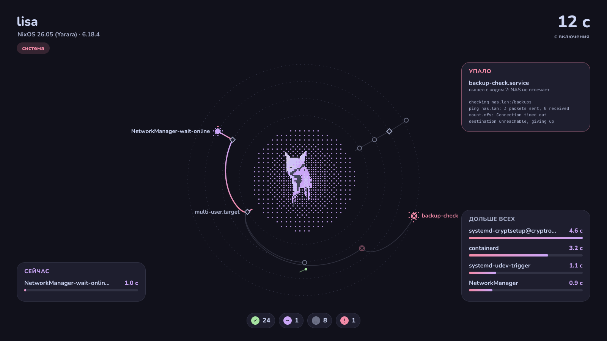
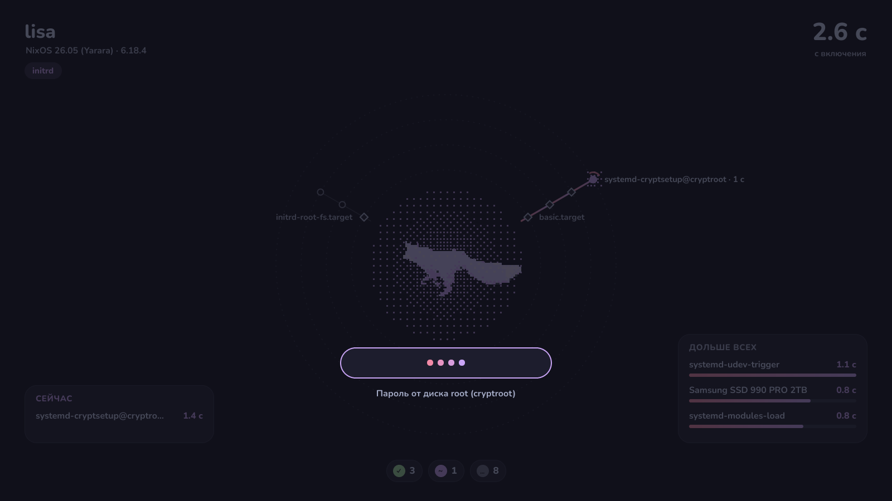
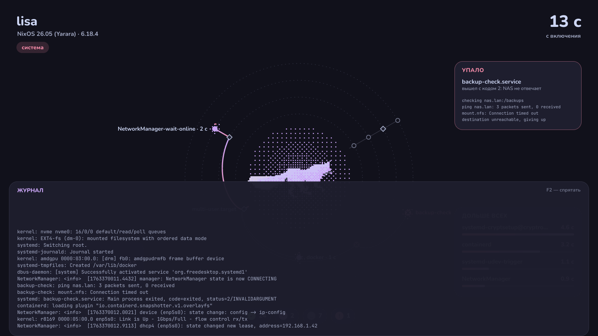

# bento-boot

[](https://slint.dev)

Экран загрузки вместо Plymouth. Пока systemd поднимает систему, юниты
летают по орбитам вокруг дизеринговой лисы: в центре цель загрузки, на
каждом следующем кольце то, чего ждут на предыдущем, а розовая дуга
показывает критический путь до юнита, который тормозит дольше всех.
Пароль от LUKS вводится точками, как на локе из quickshell и на входе в
SDDM. Экран работает с первых секунд initrd, переезжает вместе с systemd в
настоящий корень и уходит перед SDDM.



| Пароль от диска | Журнал по F2 |
| --- | --- |
|  |  |

## Что на экране

- **Орбиты.** Точка — юнит, у которого есть задача. Ромбы — цели
  (`*.target`). Пустой кружок ждёт, заполненный работает: вокруг него
  дуга таймаута, к концу она краснеет. Закончившийся юнит падает в лису.
  Упавший остаётся на кольце красным крестиком, а упавший только из-за
  зависимости — тусклым.
- **Сейчас**: что работает дольше всех, с полоской до таймаута.
- **Дольше всех**: самые медленные из уже закончившихся.
- **Упало**: юнит, причина (код выхода, сигнал, таймаут, `STATUS=` от
  сервиса) и его последние строки из журнала.
- **F2 или Tab**: шторка с хвостом журнала этой загрузки. Пока журнала
  ещё нет, там сообщения ядра из `/dev/kmsg`.
- **Пароль**: когда что-то спрашивает пароль через агент systemd (обычно
  `systemd-cryptsetup`), под лисой появляется поле. Enter отправляет,
  Esc отказывается, Ctrl+U стирает. Неверный пароль — поле трясётся и
  просит ещё раз.

## NixOS

```nix
# flake.nix
inputs.bento-boot = {
  url = "github:MichaAI/bento-boot";
  inputs.nixpkgs.follows = "nixpkgs";
};

# configuration.nix
imports = [ inputs.bento-boot.nixosModules.default ];

boot.plymouth.enable = false;   # bento-boot его заменяет

michaai.bootScreen = {
  enable = true;
  fox.animation = "Run";        # Survey, Walk, Run или "" — просто крутиться
  # fox.model = ./Fox.glb;      # своя модель; по умолчанию лиса Khronos
  colors.accent = "#cba6f7";    # любые цвета темы, см. ниже
  screen.bounce = 0.6;          # насколько пружинят точки, 0…1
};

# Чтобы картинка была с первых секунд, драйвер видеокарты должен быть в
# initrd, например:
boot.initrd.kernelModules = [ "amdgpu" ];   # или i915, nouveau…
```

Модуль кладёт один и тот же юнит `bento-boot.service` в initrd и в
систему, а `bento-boot-quit.service` гасит экран перед
`display-manager.service`, как `plymouth-quit`. По умолчанию модуль ещё
делает загрузку тихой (`quiet`, уровень логов ядра 3); выключается через
`michaai.bootScreen.quiet = false`.

## Настройка

Всё лежит в `/etc/bento-boot.toml`; модуль собирает его из опций
`colors`, `screen` и `fox`. Каждый ключ необязателен.

```toml
[colors]          # по умолчанию Catppuccin Mocha
base = "#11111b"
surface = "#1e1e2e"
rings = "#313244"
overlay = "#6c7086"
subtext = "#a6adc8"
text = "#cdd6f4"
accent = "#cba6f7"    # работающие юниты, рамка пароля
accent2 = "#f38ba8"   # начало градиентов
red = "#f38ba8"
green = "#a6e3a1"
yellow = "#f9e2af"

[screen]
scale = 0                    # 0 — по высоте экрана (1080p = 1)
dither = 3                   # клетка дизеринга свечения, px
tiles = true                 # плитки по бокам
hide_runs_shorter_than = 300 # мс
linger = 700                 # сколько постоять после загрузки, мс
bounce = 0.45                # 0 — плавно, 1 — пружинит

[fox]
frames = "/nix/store/…-bento-boot-fox"   # кадры; без них в центре планета
fps = 30
size = 320
pixel = 4                    # клетка дизеринга лисы, px кадра
palette = []                 # 4 цвета от тёмного к светлому; пусто — из темы
```

## Посмотреть без перезагрузки

```sh
nix run github:MichaAI/bento-boot -- preview --out preview --apng 15
```

`preview` проигрывает придуманную загрузку: пароль от диска (сначала
неверный), переезд в корень, медленную сеть, упавший юнит и шторку
журнала. Кадры сохраняются в PNG, `--apng 15` дописывает анимацию в
`preview/boot.png`. Нужен только процессор, ни дисплей, ни видеокарта не
нужны. `--size 2560x1440 --scale 1.33` — другой экран, `--at 1,5.5,12` —
свои моменты, `--config` — свой конфиг.

Настоящая загрузка в виртуалке, со скриншотами каждые 10 секунд:

```sh
nix build .#checks.x86_64-linux.boot -L    # скриншоты в result/
```

## Как это устроено

- `crates/model` — состояние загрузки из событий systemd: кто кого ждёт
  (по `After=`/`Before=` юнитов с задачами) и раскладка по кольцам.
- `crates/systemd` — разговор с PID 1 через его приватный сокет
  `/run/systemd/private` (в initrd шины ещё нет). Свой маленький клиент
  D-Bus: systemd подписывает там сообщения именем
  `org.freedesktop.systemd1`, на котором библиотеки спотыкаются. При
  переезде из initrd экран ждёт, пока PID 1 окажется в новом корне, и
  делает `chroot("/proc/1/root")`. Журнал читается напрямую из файлов.
- `crates/secret` — агент паролей по протоколу systemd
  (`/run/systemd/ask-password`): пароль лежит в одном массиве
  фиксированного размера, который не двигается, обнуляется после
  отправки и при удалении символов, заперт в RAM (`mlock`) и не попадает
  в дампы. Ответ уходит только в сокет root внутри каталога агентов.
  Пока экран на месте, клавиатура консоли выключена: нажатия идут только
  ему.
- `crates/app` — Slint на голом KMS (`linuxkms`) с программным рендером:
  видеокарта не нужна, хватает даже `simpledrm` от прошивки. Орбиты
  рисует tiny-skia, лиса дизерится в цвета темы на лету.

## Чего пока нет

- Экрана выключения и восстановления из гибернации.
- Если в initrd нет драйвера видеокарты, экран стартует на `simpledrm`,
  а когда приезжает настоящий драйвер, перезапускается на нём и теряет
  уже показанную историю.
- Пароль набирается в раскладке `michaai.bootScreen.keyboardLayout`
  (по умолчанию `us`), как и в консоли.

## Лиса

Модель по умолчанию — [Fox](https://github.com/KhronosGroup/glTF-Sample-Assets/tree/main/Models/Fox)
из glTF Sample Assets:

- модель — PixelMannen, [CC0 1.0](https://creativecommons.org/publicdomain/zero/1.0/);
- риггинг и анимации — tomkranis, [CC BY 4.0](https://creativecommons.org/licenses/by/4.0/);
- перевод в glTF — @AsoboStudio и @scurest, [CC BY 4.0](https://creativecommons.org/licenses/by/4.0/).

В репо её нет: сборка скачивает её с закреплённого коммита.

## Лицензии

Код bento-boot — MIT или Apache-2.0, на выбор. Интерфейс сделан на
[Slint](https://slint.dev) по лицензии
[Slint Royalty-free Desktop, Mobile, and Web Applications License 2.0](https://github.com/slint-ui/slint/blob/master/LICENSES/LicenseRef-Slint-Royalty-free-2.0.md),
отсюда бейдж наверху. Шрифты — Nunito и JetBrains Mono, обе под
SIL Open Font License 1.1.
